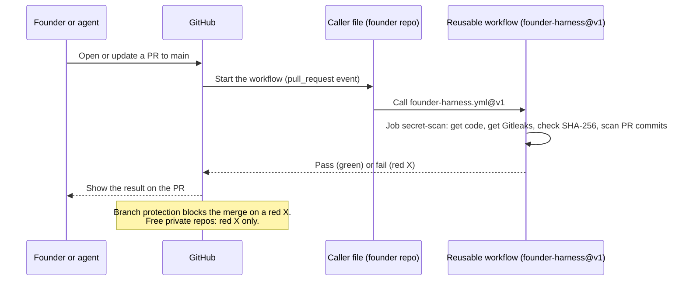

# Founder Harness: Architecture Overview

- Version: 0.1 (prototype)
- Status: Draft. The Product Owner must approve it.
- Date: 2026-11-23
- Sources: `../product/prd.md` v0.1, `../product/product-backlog.md`
- Scope: the rough design for all Sprints. Each feature spec (Spec Kit `plan.md`) gives the details.

## 1. Parts

| Part | Where | What it does |
|---|---|---|
| Reusable workflow | `founder-harness/.github/workflows/founder-harness.yml` | Runs the checks. It starts only when a caller file calls it (`on: workflow_call`). |
| Caller file | Founder repo: `.github/workflows/founder-harness.yml` | Starts on each PR to `main`. It calls the reusable workflow `@v1`. |
| Example caller file | `founder-harness/examples/caller.yml` | The founder copies this file. |
| Setup guide | `founder-harness/docs/setup-guide.md` | Steps to add the caller file and to set branch protection. |
| Checks | Jobs in the reusable workflow | One job per check. Sprint 1 has one job: `secret-scan`. |

The `founder-harness` repo is public. The founder repo can be public or private.

Owner: the personal account `SpiderPig107` owns `SpiderPig107/founder-harness`. The co-founder is a collaborator.
The founders plan a free GitHub organization later. Then they move the repo to the organization.

## 2. Flow of one PR

## 3. Decisions

### AD-1: Run the Gitleaks program directly

- Decision: the job downloads the Gitleaks program from the official GitHub release. It does not use `gitleaks-action`.
- The workflow fixes one Gitleaks version.
- The workflow checks the SHA-256 checksum of the download. If the checksum is wrong, the job fails.
- Why: `gitleaks-action` needs a licence key for organisation accounts. Since v2, it has no open-source licence. The Gitleaks program is MIT. (Checked: gitleaks-action README.)
- Effect: no founder needs a key or a sign-up form.

### AD-2: Founders use `@v1`

- Decision: the caller file uses `@v1`. `v1` is a moving tag. It points to the newest `v1.x.y` release.
- Each release also gets a fixed tag, for example `v1.0.0`.
- A change that can break founder repos gets a new major tag, `v2`.
- Requirement: the owner and each collaborator use 2-factor login on GitHub. A collaborator with write access can also move a tag.
- Why: updates reach all founder repos with no work for the founder.
- Risk: a person with access to the owner account can move `v1` to bad code. (Checked: GitHub secure-use guide.)
- Later idea: SHA pinning in the caller file.

### AD-3: Scan only the PR commits

- Decision: the job scans each commit from the PR base to the PR head.
- Command form: `gitleaks git --log-opts="<base SHA>..<head SHA>"`. (Checked: Gitleaks README.)
- The checkout gets the full Git history (`fetch-depth: 0`), so both SHAs are present.
- Why: it is fast. Old secrets in the repo do not make every PR fail.
- It finds a secret that one commit adds and a later commit deletes. A scan of only the current files misses it.
- Limit: old secrets already in the repo stay hidden.
- Later idea: a one-time full-history scan, started by hand.

### AD-4: Least permissions

- The reusable workflow asks only for `contents: read`.
- It writes no PR comments. The founder reads the findings in the job log.
- The job uses `--redact`, so the log does not show the secret value.
- Actions that the harness uses, for example `actions/checkout`, are pinned to a full commit SHA.

### AD-5: False positives

- The founder marks a finding as safe with a `.gitleaksignore` file or a `gitleaks:allow` comment.
- The setup guide explains both. (Not checked: exact syntax. Check it in the PB-02 spec.)

## 4. Branch protection

- The founder adds the check as a required status check on `main`.
- Not checked: the exact name that GitHub shows for a job in a reusable workflow. Check it in Sprint 1.
- Public repos and paid-plan repos: GitHub blocks the merge on a red X.
- Free private repos: GitHub shows the red X, but it does not block the merge. (Checked: GitHub docs.)

## 5. Cost

- GitHub Actions minutes are free for public repos.
- Private repos have a monthly free limit (not checked). The setup guide must state this.
- Gitleaks is free (MIT).

## 6. Open items for Sprint 1

1. Which Gitleaks version to fix? Use the newest stable release at the start of Sprint 1.
2. The required status check name (section 4).
3. A move of the repo to an organization changes the path in the caller file. Not checked: whether GitHub redirects the old `uses:` path. Check it before the move.
4. A tag ruleset can stop collaborators from moving `v1`. Not checked: whether it works on a personal public repo on the Free plan.
