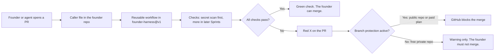

# Founder Harness: Product Requirements Document (PRD)

- Version: 0.1 (prototype)
- Status: Approved by the Product Owner on 2026-11-23.
- Date: 2026-11-23
- Product Owner: Gamaliel
- Method: Scrum for the project. GitHub Spec Kit for each feature spec.

## 1. Problem

A single founder uses AI agents to write the code of a product.
Agents make errors. For example, they put API keys in code, or they add packages with security holes.
The founder has no engineer to review each change.
Thus, bad code can reach the `main` branch, and then the live product.

## 2. Product vision (long term)

A founder builds a product and adds features with AI agents.
The founder does not need to hire engineers or designers.
Only secure, efficient and reliable code reaches `main`.
Deterministic checks (scripts) and non-deterministic checks (AI agents) guard each change.

## 3. Product Goal (prototype)

A founder adds an automatic quality gate to a GitHub repo.
The gate stops bad code before it reaches `main`.

## 4. Users

- First users: the Product Owner and 2-5 founder friends.
- Their projects: JavaScript/TypeScript and Python apps on GitHub.

## 5. Scope

### In scope (prototype)

1. A public GitHub repo `founder-harness`. It contains a reusable GitHub Actions workflow.
2. A caller file: one short YAML file that the founder adds to the founder repo.
3. A setup guide: how to add the caller file and how to set branch protection on `main`.
4. Checks, added one by one in Sprints. The Product Backlog gives the order.

### Out of scope (prototype)

- AI review of code (for example Devin Review).
- Local Git hooks on the founder's computer.
- Languages other than JavaScript/TypeScript and Python.
- Git hosts other than GitHub.
- Automatic fixes of findings.
- Paid tools and paid services.

## 6. How it works

## 7. Success metric

1. A founder adds the harness to a repo in 15 minutes or less.
2. A PR that contains a fake secret cannot merge. This applies to public repos and to repos on a paid GitHub plan.

## 8. Constraints and known limits

- Cost: use free tools only. If a tool or service can cost money, the docs must say so.
- The `founder-harness` repo must be public. A reusable workflow in a private repo is available only inside the same account or organisation (checked: GitHub Docs, "Reusing workflow configurations").
- On the free GitHub plan, branch protection and rulesets work only in public repos (checked: GitHub Docs, "About protected branches"). In a free private repo, the check shows a red X, but GitHub does not block the merge.
- GitHub Actions minutes: free for public repos. Private repos have a monthly free limit (not checked).

## 9. Risks

| Risk | Effect | Response |
|---|---|---|
| A founder merges with a red X in a free private repo. | Bad code reaches `main`. | The setup guide states the limit and the paid-plan option. |
| An old repo has secrets in its Git history. | The first run fails, and the founder does not know why. | The harness scans only the PR commits (AD-3). A one-time full-history scan is a later idea. |
| A check reports a problem that is not real (false positive). | The founder loses trust and removes the gate. | The setup guide explains how to mark a finding as safe. |

## 10. Open questions (answered)

The Architecture Overview answers the 3 questions: `../architecture/architecture-overview.md`.

1. Gitleaks: run the free Gitleaks program directly (AD-1).
2. Versions: founder repos use `@v1` (AD-2).
3. Secret scan range: only the commits in the PR (AD-3).
